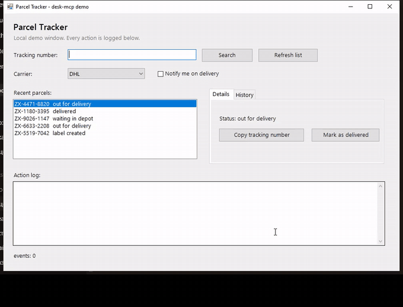
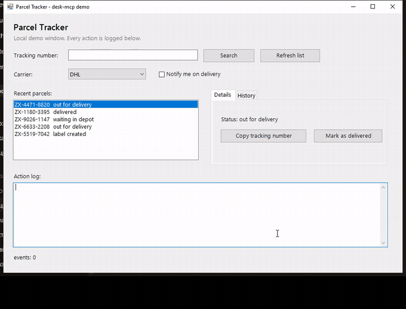

# desk-mcp

<p align="center">
  <a href="README.md">English</a> | <a href="README.ru.md">Русский</a>
</p>

<p align="center">
  <a href="https://glama.ai/mcp/servers/DigitalDog1/desk-mcp"></a>
  
  
  
  
</p>

**Give your AI assistant eyes and hands on Windows.**

Read tables, find controls by name, fill forms and verify the result. Use screenshots, OCR and mouse input when an app only exposes pixels.

**46 MCP tools. Node.js + Windows PowerShell. No native npm modules, Python or .NET SDK to install.** The UIA helper compiles at startup using Windows' built-in `Add-Type`.

[Quick start](#quick-start) · [Usage](#usage) · [Tools](#tools) · [Configuration](#configuration) · [Benchmarks](#benchmarks) · [Русский](README.ru.md)

<h3 align="center">⚡ Live Demo: 10 Actions in 2.2 Seconds (Hands-Off)</h3>



<p align="center"><sub>24 seconds, muted. <a href="https://raw.githubusercontent.com/DigitalDog1/desk-mcp/main/docs/demo.mp4">MP4</a> or <a href="https://raw.githubusercontent.com/DigitalDog1/desk-mcp/main/docs/demo.webm">WebM</a> for the full size file.</sub></p>

The recording uses the included Parcel Tracker app. UI Automation patterns fill fields and press controls without moving the cursor.


## Quick start

**Requirements:** Windows 10 1809+ or Windows 11, Node.js 20+ (22/24 recommended), Git and an unlocked interactive desktop. Windows PowerShell 5.1 is included with Windows.

```powershell
git clone https://github.com/DigitalDog1/desk-mcp.git
cd desk-mcp
npm ci
```

Add the server to your MCP client's configuration. Replace the path with the **absolute path** to your clone:

```json
{
  "mcpServers": {
    "desk-mcp": {
      "command": "node",
      "args": ["C:/tools/desk-mcp/server.mjs"]
    }
  }
}
```

This example is for clients using `mcpServers`; other clients may use a different configuration format. If Node is not found, use `C:/Program Files/nodejs/node.exe` as `command`. Restart the client after configuration or code changes.

**Use the clone for now:** the npm registry returned 404 for `desk-mcp` on 2026-11-13. The previously documented `npx -y desk-mcp` command requires a published package.

Ask your assistant to call `computer_permissions`, list windows with `computer_windows`, and inspect the window you choose.

To reproduce the demo, run these commands in **two terminals** from the clone:

```powershell
powershell -NoProfile -ExecutionPolicy Bypass -STA -File examples/demo-app.ps1
```

```powershell
node examples/demo.mjs
```

The demo changes only its Parcel Tracker window and uses the clipboard. The recorded timings depend on the machine.

## Usage

**Find the window → inspect → act → verify.**

- Use `hwnd` from `computer_windows` when titles change. Get a fresh handle after a window closes.
- Find a control by `id` (AutomationId), `name`, `type` or `nameRegex`. `requireUnique: true` refuses ambiguous or incomplete searches.
- Pass its `elementId` to `computer_invoke`, `computer_set_value` or `computer_select`. References expire when the worker restarts or the element disappears.
- Verify the resulting value or state. An input event being sent does not establish success.

For example, pass this to `computer_batch`:

```json
{
  "steps": [
    { "tool": "computer_find", "args": { "title": "Parcel Tracker", "id": "searchBox", "requireUnique": true } },
    { "tool": "computer_set_value", "args": { "elementId": "${steps.0.elements.0.elementId}", "value": "ZX-9026-1147" } },
    { "tool": "computer_find", "args": { "title": "Parcel Tracker", "id": "searchBox" } }
  ]
}
```

Batches support up to 50 worker-tool steps, validate each step, and stop on errors unless `stopOnError: false` is set. Exact references preserve their value's type. Inspect `allOk` and each step's `code`; earlier actions are not rolled back. Browser tools and nested batches are not supported in a batch.

For smaller trees, use `maxDepth: 4, interactiveOnly: true, compact: true`. For repeated reads, use `mode: auto` and pass the last `token` as `since` with the same options. A stale baseline or a diff larger than the full view returns the full view. Check `truncated` and `searchIncomplete` before concluding that something is absent.

`computer_set_value` defaults to ValuePattern without focus. Use `inputMode: type` or `paste` for forms needing keyboard events. `computer_type` always types into the **currently focused** control. Paste uses the clipboard.

## The same window with the cursor



<p align="center"><sub>Same window, same visible result, other mechanism. <a href="https://raw.githubusercontent.com/DigitalDog1/desk-mcp/main/docs/demo-cursor.mp4">MP4</a> or <a href="https://raw.githubusercontent.com/DigitalDog1/desk-mcp/main/docs/demo-cursor.webm">WebM</a> for the full size version.</sub></p>

Coordinate input moves the real cursor. For controls that need a hover before the press, use `hoverFirst: true` (250 ms).

## Tools

Full argument schemas are available in your MCP client.

| Group | Tools |
| --- | --- |
| Screen | `computer_screenshot`, `computer_ocr`, `computer_screeninfo` |
| Accessibility | `computer_read_screen`, `computer_find`, `computer_element_at`, `computer_read_table` |
| Controls | `computer_invoke`, `computer_set_value`, `computer_select`, `computer_select_text` |
| Verification | `computer_verify_state`, `computer_wait_element`, `computer_wait_window` |
| Mouse | `computer_click`, `computer_move`, `computer_cursor`, `computer_mouse_move`, `computer_mouse_button`, `computer_drag`, `computer_polyline`, `computer_scroll` |
| Keyboard | `computer_type`, `computer_key`, `computer_key_down`, `computer_key_up` |
| Windows | `computer_windows`, `computer_active_window`, `computer_focus`, `computer_window_set_frame`, `computer_close_window`, `computer_launch`, `computer_desktop` |
| Browser | `computer_browser_start`, `computer_browser_list`, `computer_browser_tree`, `computer_browser_descendants`, `computer_browser_click`, `computer_browser_eval` |
| Utilities | `computer_clipboard_get`, `computer_clipboard_set`, `computer_wait`, `computer_batch`, `computer_permissions`, `computer_selftest`, `computer_bench` |

`computer_read_screen` falls back from UIA to MSAA and then OCR. **CDP browser tools are separate** and use a dedicated Chrome/Edge profile. UIA patterns can leave the cursor untouched; pixel fallbacks and keyboard input can take focus. Check `via` and `backend`.

## Configuration

Set these in the server entry's `env` object:

| Variable | Default | Purpose |
| --- | --- | --- |
| `DESK_DRY_RUN` | off | `1` returns plans for mutating worker tools and browser start/click/eval. |
| `DESK_DISABLE_TOOLS` | empty | Comma-separated MCP tool names; `*` wildcards supported. Also enforced for batch aliases. |
| `DESK_ALLOW_TITLES` | empty | Pipe-separated substrings matched against supplied worker window titles. |
| `DESK_AUDIT` / `DESK_AUDIT_PATH` | off / `%TEMP%/desk-mcp-audit.log` | Worker text log, not JSONL. Does not cover CDP. The parent directory must exist. |
| `DESK_UI_TIMEOUT_MS` | `8000` | Server UIA deadline, including startup. |
| `DESK_UI_COOLDOWN_MS` | `90000` | Cooldown for the same tool/target after a timeout. |
| `DESK_UIA_BUDGET_MS` | `6000` | Native STA operation budget. |

`computer_launch` and `computer_close_window` require `confirm: true`. The title filter is **not a sandbox**: untitled input, handles, element references and CDP need separate restrictions. Disable unnecessary tools and use a separate Windows session for unattended work.

## Limitations and troubleshooting

- Run in an interactive Windows session. Services, locked sessions, protected windows and exclusive fullscreen games can block input or capture.
- After a UIA timeout, use screenshot/OCR or another target during cooldown. A worker restart rejects other pending calls too; re-read state before retrying an action that may already have reached the app.
- If a pixel click is ignored, try `hoverFirst: true`. Match `scale` to the screenshot; use `nudge` or drag on a canvas.
- `computer_read_table` treats the first row as a header by convention. Use `headers: false` to retain it as data.
- `computer_selftest` briefly presses Shift to check SendInput, even in dry-run. Held keys and buttons must be explicitly released.
- Tool errors include MCP `isError` and a `code:` line. Batches carry error codes per step. A condition timeout from `computer_wait_element` returns `satisfied: false`, `reason: timeout`.

## Benchmarks

See [method and reproducible results](docs/benchmarks.md). Reading latency, response size and completed-task latency are separate measurements. No simulated screenshot agent or invented LLM delay is used.

## Development

```powershell
npm ci
npm run check
npm run test:unit
npm run check:docs
npm test
npm pack --dry-run
```

The Windows smoke test reads live windows and exercises Parcel Tracker if open. It does not type into an arbitrary active window. Selftest briefly presses Shift; browser launching is opt-in with `DESK_TEST_CDP=1`. Keep `worker.ps1` in UTF-8 **with BOM** and the UIA helper compatible with C# 5.

[Contributing](CONTRIBUTING.md) · [Architecture](AGENTS.md) · [Changelog](CHANGELOG.md) · [Publishing](docs/PUBLISHING.md) · [Third-party notices](THIRD_PARTY_NOTICES.md)

## License

[Apache License 2.0](LICENSE).
