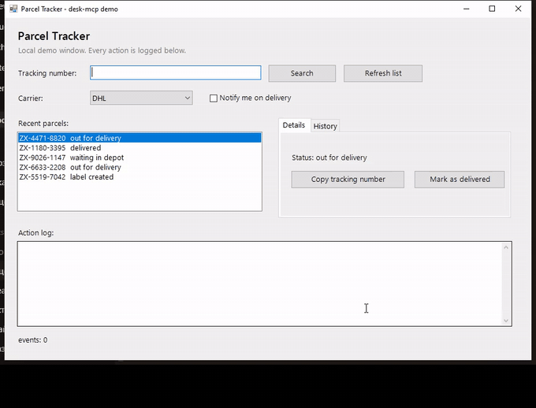
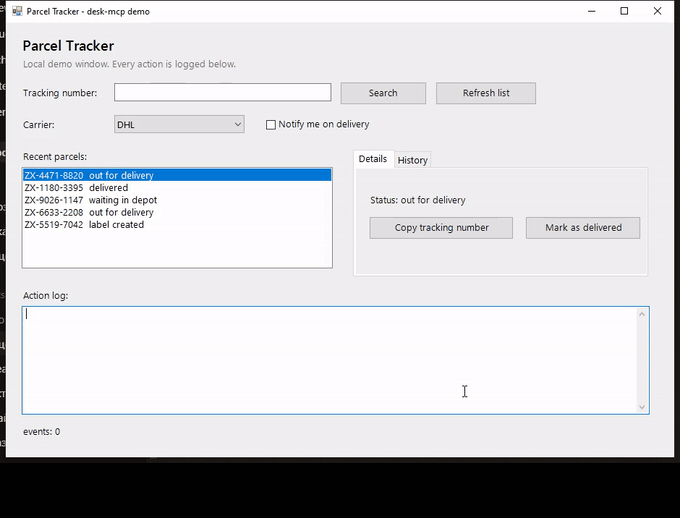

# desk-mcp

<p align="center">
  <a href="README.md">English</a> | <a href="README.ru.md">Русский</a>
</p>

<p align="center">
  <a href="https://glama.ai/mcp/servers/DigitalDog1/desk-mcp"></a>
  
  
  
  
</p>

**Глаза и руки вашего AI-ассистента в Windows.**

Чтение таблиц, поиск элементов по имени, заполнение форм и проверка результата. Там, где приложение отдаёт только пиксели, — скриншоты, OCR и управление мышью.

**46 MCP-инструментов. Node.js + Windows PowerShell. Без нативных npm-модулей, Python и отдельного .NET SDK.** UIA-помощник компилируется при запуске встроенным в Windows `Add-Type`.

[Быстрый старт](#быстрый-старт) · [Использование](#использование) · [Инструменты](#инструменты) · [Настройка](#настройка) · [Бенчмарки](#бенчмарки) · [English](README.md)

<h3 align="center">⚡ Живое демо: 10 действий за 2.2 секунды (Hands-Off)</h3>



<p align="center"><sub>24 секунды, без звука. <a href="https://raw.githubusercontent.com/DigitalDog1/desk-mcp/main/docs/demo.mp4">MP4</a> или <a href="https://raw.githubusercontent.com/DigitalDog1/desk-mcp/main/docs/demo.webm">WebM</a>, если нужен полный размер.</sub></p>

В записи используется приложение Parcel Tracker из репозитория. UI Automation заполняет поля и нажимает элементы без движения курсора.


## Быстрый старт

**Требования:** Windows 10 1809+ или Windows 11, Node.js 20+ (рекомендуется 22/24), Git и разблокированный интерактивный рабочий стол. Windows PowerShell 5.1 уже входит в Windows.

```powershell
git clone https://github.com/DigitalDog1/desk-mcp.git
cd desk-mcp
npm ci
```

Добавьте сервер в конфигурацию MCP-клиента. Замените путь на **абсолютный путь** к своему клону:

```json
{
  "mcpServers": {
    "desk-mcp": {
      "command": "node",
      "args": ["C:/tools/desk-mcp/server.mjs"]
    }
  }
}
```

Пример рассчитан на клиентов с ключом `mcpServers`; у других формат может отличаться. Если Node не найден, укажите `C:/Program Files/nodejs/node.exe` в `command`. После изменения конфигурации или кода перезапустите клиент.

**Пока запускайте из клона:** 13 ноября 2026 года npm-реестр возвращал 404 для `desk-mcp`. Ранее указанная команда `npx -y desk-mcp` требует опубликованного пакета.

Попросите ассистента вызвать `computer_permissions`, получить список окон через `computer_windows` и прочитать выбранное вами окно.

Чтобы повторить демо, выполните команды из клона в **двух терминалах**:

```powershell
powershell -NoProfile -ExecutionPolicy Bypass -STA -File examples/demo-app.ps1
```

```powershell
node examples/demo.mjs
```

Демо меняет только своё окно Parcel Tracker и использует буфер обмена. Время из записи зависит от машины.

## Использование

**Найти окно → прочитать → выполнить действие → проверить результат.**

- Если заголовок меняется, используйте `hwnd` из `computer_windows`. После закрытия окна получите новый дескриптор.
- Ищите элемент по `id` (AutomationId), `name`, `type` или `nameRegex`. `requireUnique: true` отклоняет неоднозначный или неполный поиск.
- Передавайте полученный `elementId` в `computer_invoke`, `computer_set_value` или `computer_select`. Ссылка перестаёт работать после перезапуска воркера или исчезновения элемента.
- Проверяйте итоговое значение или состояние. Отправленное событие ввода ещё не означает успех.

Например, передайте в `computer_batch`:

```json
{
  "steps": [
    { "tool": "computer_find", "args": { "title": "Parcel Tracker", "id": "searchBox", "requireUnique": true } },
    { "tool": "computer_set_value", "args": { "elementId": "${steps.0.elements.0.elementId}", "value": "ZX-9026-1147" } },
    { "tool": "computer_find", "args": { "title": "Parcel Tracker", "id": "searchBox" } }
  ]
}
```

Пакет содержит до 50 шагов с инструментами воркера, проверяет аргументы каждого и останавливается на ошибке, если не задано `stopOnError: false`. Ссылка, занимающая всё значение, сохраняет его тип. Проверяйте `allOk` и `code` каждого шага: выполненные действия не откатываются. Браузерные инструменты и вложенные пакеты внутри пакета не поддерживаются.

Для небольшого дерева задайте `maxDepth: 4, interactiveOnly: true, compact: true`. Для повторных чтений используйте `mode: auto` и передавайте последний `token` как `since` с теми же параметрами. При устаревшей базе или слишком большой дельте вернётся полный ответ. Проверяйте `truncated` и `searchIncomplete`, прежде чем считать элемент отсутствующим.

`computer_set_value` по умолчанию использует ValuePattern без фокуса. Для форм, которым нужны события клавиатуры, есть `inputMode: type` и `paste`. `computer_type` всегда печатает в **текущее активное поле**. Вставка использует буфер обмена.

## То же окно, но через курсор



<p align="center"><sub>То же окно, тот же результат, другой механизм. <a href="https://raw.githubusercontent.com/DigitalDog1/desk-mcp/main/docs/demo-cursor.mp4">MP4</a> или <a href="https://raw.githubusercontent.com/DigitalDog1/desk-mcp/main/docs/demo-cursor.webm">WebM</a> для полного размера.</sub></p>

Координатный ввод перемещает настоящий курсор. Для элементов, которым нужно наведение перед нажатием, используйте `hoverFirst: true` (250 мс).

## Инструменты

Полные схемы аргументов доступны в вашем MCP-клиенте.

| Группа | Инструменты |
| --- | --- |
| Экран | `computer_screenshot`, `computer_ocr`, `computer_screeninfo` |
| Accessibility | `computer_read_screen`, `computer_find`, `computer_element_at`, `computer_read_table` |
| Элементы | `computer_invoke`, `computer_set_value`, `computer_select`, `computer_select_text` |
| Проверка | `computer_verify_state`, `computer_wait_element`, `computer_wait_window` |
| Мышь | `computer_click`, `computer_move`, `computer_cursor`, `computer_mouse_move`, `computer_mouse_button`, `computer_drag`, `computer_polyline`, `computer_scroll` |
| Клавиатура | `computer_type`, `computer_key`, `computer_key_down`, `computer_key_up` |
| Окна | `computer_windows`, `computer_active_window`, `computer_focus`, `computer_window_set_frame`, `computer_close_window`, `computer_launch`, `computer_desktop` |
| Браузер | `computer_browser_start`, `computer_browser_list`, `computer_browser_tree`, `computer_browser_descendants`, `computer_browser_click`, `computer_browser_eval` |
| Служебные | `computer_clipboard_get`, `computer_clipboard_set`, `computer_wait`, `computer_batch`, `computer_permissions`, `computer_selftest`, `computer_bench` |

`computer_read_screen` переходит с UIA на MSAA, затем на OCR. **Браузерные CDP-инструменты работают отдельно**, в выделенном профиле Chrome/Edge. UIA-паттерны могут работать без движения курсора; пиксельный откат и клавиатурный ввод могут забирать фокус. Проверяйте `via` и `backend`.

## Настройка

Задайте переменные в объекте `env` конфигурации сервера:

| Переменная | По умолчанию | Назначение |
| --- | --- | --- |
| `DESK_DRY_RUN` | выкл. | `1` возвращает планы для изменяющих состояние инструментов воркера и browser start/click/eval. |
| `DESK_DISABLE_TOOLS` | пусто | MCP-имена через запятую; поддерживается `*`. Действует и на короткие имена в пакетах. |
| `DESK_ALLOW_TITLES` | пусто | Подстроки через вертикальную черту, проверяемые в переданных заголовках окон воркера. |
| `DESK_AUDIT` / `DESK_AUDIT_PATH` | выкл. / `%TEMP%/desk-mcp-audit.log` | Текстовый журнал воркера, не JSONL. Не охватывает CDP. Родительский каталог должен существовать. |
| `DESK_UI_TIMEOUT_MS` | `8000` | Дедлайн UIA на сервере, включая запуск воркера. |
| `DESK_UI_COOLDOWN_MS` | `90000` | Пауза для того же инструмента и цели после таймаута. |
| `DESK_UIA_BUDGET_MS` | `6000` | Бюджет нативной STA-операции. |

`computer_launch` и `computer_close_window` требуют `confirm: true`. Фильтр заголовков — **не песочница**: ввод без заголовка, дескрипторы, ссылки на элементы и CDP требуют отдельных ограничений. Для автономной работы отключайте ненужные инструменты и используйте отдельную сессию Windows.

## Ограничения и диагностика

- Нужна интерактивная сессия Windows. Службы, заблокированные сессии, защищённые окна и эксклюзивный полноэкранный режим могут блокировать ввод или захват.
- После таймаута UIA используйте скриншот/OCR или другую цель до окончания паузы. Перезапуск воркера отклоняет и другие ожидающие вызовы; перед повтором действия перечитайте состояние — оно уже могло дойти до приложения.
- Если пиксельный клик игнорируется, попробуйте `hoverFirst: true`. Согласуйте `scale` со снимком; для холста используйте `nudge` или протяжку.
- `computer_read_table` считает первую строку заголовком по соглашению. `headers: false` сохраняет её как данные.
- `computer_selftest` кратко нажимает Shift для проверки SendInput, даже в dry-run. Зажатые клавиши и кнопки нужно явно отпускать.
- Ошибки содержат MCP `isError` и строку `code:`. В пакетах код указан у каждого неудачного шага. Таймаут условия в `computer_wait_element` возвращает `satisfied: false`, `reason: timeout`.

## Бенчмарки

[Методика и воспроизводимые результаты](docs/benchmarks.md). Задержка чтения, размер ответа и время завершённой задачи измеряются отдельно. Без симуляции скриншотного агента и придуманной задержки LLM.

## Разработка

```powershell
npm ci
npm run check
npm run test:unit
npm run check:docs
npm test
npm pack --dry-run
```

Windows smoke-тест читает живые окна и проверяет элементы Parcel Tracker, если оно открыто. В произвольное активное окно он не печатает. Selftest кратко нажимает Shift; запуск браузера включается отдельно через `DESK_TEST_CDP=1`. Сохраняйте `worker.ps1` в UTF-8 **с BOM**, а UIA-помощник — совместимым с C# 5.

[Участие](CONTRIBUTING.md) · [Архитектура](AGENTS.md) · [История изменений](CHANGELOG.md) · [Публикация](docs/PUBLISHING.md) · [Лицензии зависимостей](THIRD_PARTY_NOTICES.md)

## Лицензия

[Apache License 2.0](LICENSE).
